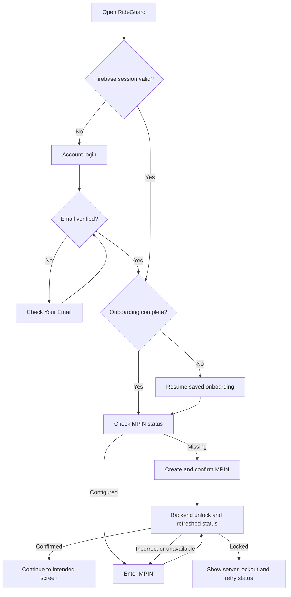

# RideGuard MPIN flow and endpoint audit

Verified against `XpnsiveSharks/rideguard-node`, branch `development`, commit
`9b40d3d36b5ec80441388f745cffe77509b6f4f4` on 2026-10-25.

Source: [MPIN controller](https://github.com/XpnsiveSharks/rideguard-node/blob/9b40d3d36b5ec80441388f745cffe77509b6f4f4/src/modules/mpin/mpin.controller.ts),
[MPIN service](https://github.com/XpnsiveSharks/rideguard-node/blob/9b40d3d36b5ec80441388f745cffe77509b6f4f4/src/modules/mpin/mpin.service.ts),
and [profile service](https://github.com/XpnsiveSharks/rideguard-node/blob/9b40d3d36b5ec80441388f745cffe77509b6f4f4/src/modules/profile/profile.service.ts).

## Purpose

MPIN unlocks an already signed-in account. It never replaces Firebase login,
verifies an email, or authenticates a logged-out user. Firebase keeps the login
session; a separate, memory-only MPIN state protects normal app screens.

## First-time user

1. Create account and sign into Firebase using the supplied credentials.
2. Call Firebase `sendEmailVerification()`. The current registration service creates
   the user but does not send this email itself.
3. Remain on Check Your Email until Firebase and `GET /auth/me` confirm verification.
4. Finalize registration using `POST /auth/register/verify` when no profile exists.
   A registration identity stub is not completed personal information.
5. Complete Profile → Vehicle → Emergency Contact → Permissions → Hardware setup.
6. Check `GET /mpin/status`. If an MPIN exists, use the existing unlock flow.
7. Otherwise show the existing Create MPIN and Confirm MPIN screens.
8. Matching entries call `POST /mpin/setup`. A local match alone never means saved.
9. After a confirmed save, call `POST /mpin/unlock` with the confirmed PIN, then
   refresh `GET /mpin/status`. This avoids a redundant third PIN entry.
10. Show Setup Complete only after profile completion and configured MPIN are
    confirmed by the backend. Continue to Dashboard.

Mismatch, timeout, network failure, malformed response, or a failed save keeps the
user in the flow. If saving may have succeeded but the response was lost, check
status before creating again. An existing PIN is unlocked, never overwritten.

## Returning user

- Cold launch requires local MPIN entry, even if the backend still has an unlock
  window from an earlier app instance or another device.
- Returning after a real background visit locks the local app. Temporary inactive
  interruptions alone do not force another entry.
- Navigating between app screens does not repeatedly request MPIN.
- Server unlock expiry also closes access. The current backend window is 15 minutes.
- Backend policy allows five failed PIN attempts and then a 15-minute lockout.
  The frontend follows returned status/deadlines instead of inventing attempt limits.
- Refreshing server status alone cannot unlock a cold or background-locked app.
- Logout and account switching discard all MPIN state. No PIN, draft PIN, grant,
  or unlocked flag is persisted or logged.
- Normal screens remain hidden during security checks. Emergency exceptions follow
  the backend's explicit permission; the current backend returns no exception.

## Current endpoint contract

The API base includes `/v1` once. Every MPIN request uses the Firebase ID token as
`Authorization: Bearer ...`; a PIN is a JSON body value and never a URL parameter.

| Operation | Method and path after base URL | JSON body | App status |
| --- | --- | --- | --- |
| Status | `GET /mpin/status?reason=launch` | None | Enabled |
| Setup | `POST /mpin/setup` | `{ pin }` | Enabled |
| Unlock | `POST /mpin/unlock` | `{ pin }` | Enabled |
| Current-PIN proof | `POST /mpin/change/authorize` | `{ pin }` | Adapter matches backend; change UI unavailable |
| Change challenge | `POST /mpin/change/code` | `{ authorization }` | Legacy OTP; not used by link flow |
| Resend change code | `POST /mpin/change/code/resend` | `{ challengeId }` | Legacy OTP |
| Verify change code | `POST /mpin/change/code/verify` | `{ challengeId, code }` | Legacy OTP |
| Save change | `POST /mpin/change` | `{ authorization, pin }` | Requires backend-issued change grant |
| Recovery challenge | `POST /mpin/recovery/code` | None | Legacy OTP; not used by link flow |
| Resend recovery code | `POST /mpin/recovery/code/resend` | `{ challengeId }` | Legacy OTP |
| Verify recovery code | `POST /mpin/recovery/code/verify` | `{ challengeId, code }` | Legacy OTP |
| Save reset | `POST /mpin/recovery/reset` | `{ authorization, pin }` | Requires backend-issued reset grant |

Responses use `{ success: true, data: ... }`. Successful writes additionally return
`data.success: true`. Status requests send `reason` only: the current backend's
optional `inactiveForMs` query field uses `@IsNumber()` without conversion from a
query string, and its service ignores that value. The local foreground policy
therefore does not depend on that unsupported numeric query parameter.

## Forgot MPIN and Change MPIN: backend work still needed

The required recovery experience uses an email link, not six-digit OTP entry.
The current backend only has code-based routes and injects `MissingMpinEmailSender`,
which returns 503. Changing endpoint names in the frontend cannot implement links.

Required flow: Forgot MPIN → request email link → open link → backend verifies its
single-use, expiring, account-bound token → issue reset authorization → create and
confirm new MPIN → save reset → explicitly unlock with the new PIN.

For Change MPIN, first verify the current PIN, then complete the email-link proof
before accepting a replacement PIN. A `change-proof` grant cannot directly save a
new PIN; the backend requires a separate `change` grant.

Until these contracts and mail delivery exist, the app shows a short unavailable
message for change/recovery and allows returning to unlock or logging out. It does
not request legacy OTP codes or pretend that a recovery link was sent. See
[the recovery link requirements](mpin-recovery-email-link.md) for the backend ticket.

## Other endpoint findings

- `GET /auth/is-old-user` now checks for `personalInfo`, not mere document existence.
  `POST /profile/personal-info` can complete an existing registration stub. The
  frontend now preserves that distinction when verifying and restoring accounts.
- Existing account edits use the implemented `PATCH /profile/me`; profile photos
  and contact CRUD routes already match the controller.
- `DELETE /devices/claim-device/:id` does not exist in the inspected backend.
  Disconnect now reports unavailability without sending an invented request or
  clearing the device locally. A release-device contract is still needed.
- The shared client, profile photo, and contacts requests use the same normalized
  API base URL. Changing the API host does not require editing those services.

## Validation and release

Unit checks cover authenticated endpoint bodies, envelopes, cold-start locking,
background locking, account switching, expiry, request cancellation, and profile
stub completion. These do not prove the deployed Azure API is on this commit.

A read-only unauthenticated Azure probe on 2026-10-25 returned HTTP 401 for
`/v1/mpin/status?reason=launch`, consistent with the protected status route being
deployed. This does not verify authenticated setup/unlock or email delivery.

Phone QA must verify setup, confirmation mismatch, existing PIN, reopen/background,
wrong attempts and lockout, offline retry, and logout. Configure a real backend
email-link recovery path before a general production rollout to avoid leaving users
without self-service recovery.

The inspected backend keeps unlock expiry per account, and ordinary API guards
check Firebase authentication rather than MPIN grants. For protection of sensitive
API operations beyond the app's screen lock, the backend needs session/device-bound
MPIN authorization and corresponding route enforcement.
