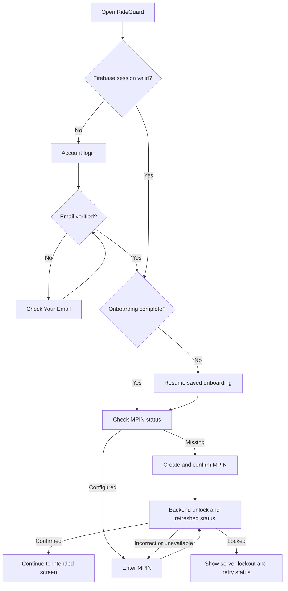

# RideGuard MPIN flow and endpoint audit

> Current integration update: [29 October staging integration](BACKEND_STAGING_INTEGRATION_2026-10-29.md).
> Device identity, lock/logout and server onboarding are now connected. The older
> audit below remains historical; the current app keeps six-digit MPIN email codes.

Updated against `XpnsiveSharks/rideguard-node` remote HEAD,
`398e2f268779dbc8e70c59b522c0e730ade983f4` on 2026-10-28.

Source: [MPIN controller](https://github.com/XpnsiveSharks/rideguard-node/blob/398e2f268779dbc8e70c59b522c0e730ade983f4/src/modules/mpin/mpin.controller.ts),
[MPIN service](https://github.com/XpnsiveSharks/rideguard-node/blob/398e2f268779dbc8e70c59b522c0e730ade983f4/src/modules/mpin/mpin.service.ts),
and [profile service](https://github.com/XpnsiveSharks/rideguard-node/blob/398e2f268779dbc8e70c59b522c0e730ade983f4/src/modules/profile/profile.service.ts).

## Purpose

MPIN unlocks an already signed-in account. It never replaces Firebase login,
verifies an email, or authenticates a logged-out user. Firebase keeps the login
session; a separate, memory-only MPIN state protects normal app screens.

## First-time user

1. Create account and sign into Firebase using the supplied credentials.
2. Call Firebase `sendEmailVerification()`. The current registration service creates
   the user but does not send this email itself.
3. Remain on Check Your Email until Firebase and `GET /auth/me` confirm verification.
4. Finalize registration using `POST /auth/register/verify` when no profile exists.
   A registration identity stub is not completed personal information.
5. Complete Profile → Vehicle → Emergency Contact → Permissions → Hardware setup.
6. Check `GET /mpin/status`. If an MPIN exists, use the existing unlock flow.
7. Otherwise show the existing Create MPIN and Confirm MPIN screens.
8. Matching entries call `POST /mpin/setup`. A local match alone never means saved.
9. After a confirmed save, call `POST /mpin/unlock` with the confirmed PIN, then
   refresh `GET /mpin/status`. This avoids a redundant third PIN entry.
10. Show Setup Complete only after profile completion and configured MPIN are
    confirmed by the backend. Continue to Dashboard.

Mismatch, timeout, network failure, malformed response, or a failed save keeps the
user in the flow. If saving may have succeeded but the response was lost, check
status before creating again. An existing PIN is unlocked, never overwritten.

Onboarding MPIN steps use `/(onboarding)/register/mpin?step=…` throughout setup,
including existing-PIN unlocking. They must not switch to the normal app's MPIN
navigator, whose completed-profile guard can redirect unfinished accounts.
Status-driven redirects run only while their MPIN screen is focused. The normal
MPIN navigator shows a loading indicator while authentication/profile checks run.

The connected phone's console showed duplicate React child keys when opening
the keypad: the empty bottom-left cell used numeric key `0`, colliding with the
digit `"0"`. The empty cell now uses a distinct placeholder key. Regression tests
render the real keypad JSX and verify sibling-key uniqueness and zero entry.
The earlier Android crash buffer did not contain a RideGuard native crash.
On 2026-10-27 the user supplied a Fabric `addViewAt` / child-already-parented
stack trace. See [the native mounting diagnosis and validation](MPIN_ANDROID_MOUNT_CRASH.md)
for the separate native-view stability changes and device verification.

The phone's other two LogBox errors came from background camera discovery
(`GET /devices/cameras`) and push registration (`POST /notifications/register`),
both reporting `Internal server error`. These requests now wait for completed
profile/onboarding; settings hardware setup keeps background monitoring enabled.
Failures retain warning diagnostics and retry on resume instead of interrupting
MPIN with a red error overlay. A failed rotated push token also remains retryable.
This does not repair server-side errors or pretend push registration succeeded.

## Returning user

- Cold launch requires local MPIN entry, even if the backend still has an unlock
  window from an earlier app instance or another device.
- Returning within three minutes of backgrounding retains an existing unlock if
  the server still accepts it. At 180 seconds or more, the app locks and shows the
  branded Session locked notice before requiring MPIN. Three minutes without
  touch, scrolling or typing while the app is open also locks it. The interval
  uses monotonic elapsed time; duplicate background events do not restart it.
- Turning the Android phone screen off requires MPIN immediately on return,
  regardless of the grace period. The local AppSecurity native module observes
  screen-off events and device lock state; this requires the updated development
  binary. Temporary inactive interruptions alone do not force another entry.
- Navigating between app screens does not repeatedly request MPIN.
- Server unlock expiry also closes access. The current backend window is 15 minutes.
- Backend policy allows five failed PIN attempts and then a 15-minute lockout.
  The frontend follows returned status/deadlines instead of inventing attempt limits.
- Refreshing server status alone cannot unlock a cold or background-locked app.
- Logout and account switching discard all MPIN state. No PIN, draft PIN, grant,
  or unlocked flag is persisted or logged.
- Normal screens remain hidden during security checks. Emergency exceptions follow
  the backend's explicit permission; the current backend returns no exception.

## Current endpoint contract

The API base includes `/v1` once. Every MPIN request uses the Firebase ID token as
`Authorization: Bearer ...`; a PIN is a JSON body value and never a URL parameter.

| Operation | Method and path after base URL | JSON body | App status |
| --- | --- | --- | --- |
| Status | `GET /mpin/status?reason=launch` | None | Enabled |
| Setup | `POST /mpin/setup` | `{ pin }` | Enabled |
| Unlock | `POST /mpin/unlock` | `{ pin }` | Enabled |
| Current-PIN proof | `POST /mpin/change/authorize` | `{ pin }` | Connected |
| Change challenge | `POST /mpin/change/code` | `{ authorization }` | Connected; requires email sender |
| Resend change code | `POST /mpin/change/code/resend` | `{ challengeId }` | Connected |
| Verify change code | `POST /mpin/change/code/verify` | `{ challengeId, code }` | Connected |
| Save change | `POST /mpin/change` | `{ authorization, pin }` | Requires backend-issued change grant |
| Recovery challenge | `POST /mpin/recovery/code` | None | Connected; requires email sender |
| Resend recovery code | `POST /mpin/recovery/code/resend` | `{ challengeId }` | Connected |
| Verify recovery code | `POST /mpin/recovery/code/verify` | `{ challengeId, code }` | Connected |
| Save reset | `POST /mpin/recovery/reset` | `{ authorization, pin }` | Requires backend-issued reset grant |

Responses use `{ success: true, data: ... }`. Successful writes additionally return
`data.success: true`. Status requests send `reason` only: the current backend's
service currently ignores the optional `inactiveForMs` value. The local foreground
policy therefore does not depend on that value establishing a server lock policy.

## Forgot MPIN and Change MPIN: six-digit email codes

On 28 October the user approved the backend's existing six-digit email-code flow.
The existing screens are connected to those routes. `MissingMpinEmailSender` still
returns 503 until a real backend sender is configured; the app displays that failure
and does not navigate to code verification as if mail were sent.

Forgot MPIN → Send reset code → Verify six-digit email code → backend reset grant →
New MPIN → Confirm → Save reset → explicitly unlock with the new PIN.

Change MPIN → Current PIN → Send/verify email code → backend change grant →
New MPIN → Confirm → Save change. A current-PIN proof cannot be passed directly to
the existing `/mpin/change` route. If status explicitly advertises direct change,
the optional patched `/mpin/change/direct` route supports skipping the code step.

The app respects server challenge deadlines, clears temporary proofs on background
and account changes, and requires a valid reset grant to bypass the old PIN lockout.
Exhausted code guesses permit resend after its cooldown. Request throttles are
separate from challenge-attempt exhaustion. See [the current backend checklist](auth-backend-requirements.md).

## Other endpoint findings

- `GET /auth/is-old-user` now checks for `personalInfo`, not mere document existence.
  `POST /profile/personal-info` can complete an existing registration stub. The
  frontend now preserves that distinction when verifying and restoring accounts.
- Existing account edits use the implemented `PATCH /profile/me`; profile photos
  and contact CRUD routes already match the controller.
- Hardware Disconnect now means unpairing for another account/phone. The frontend
  targets the required `POST /devices/release` contract and accepts only an explicit
  ownership-removal response. That endpoint is not yet implemented in the inspected
  backend; `/devices/disconnect` merely stops a session and is not used as a fallback.
  See [the backend unpair contract and privacy requirements](HARDWARE_UNPAIR_BACKEND.md).
- The shared client, profile photo, and contacts requests use the same normalized
  API base URL. Changing the API host does not require editing those services.

## Validation and release

The 28 October email-code integration passes 225 frontend tests and TypeScript.
Tests exercise the existing Forgot/Current/Code screen callbacks: mail failure
does not navigate, a real delivery opens the code step, and only a real server
grant opens New MPIN. API-contract tests cover send/resend/verify/reset, leading
zeroes, provider failure and throttles. The optional backend patch builds and
passes 14 MPIN tests, including recovery while the old PIN is locked.
See [frontend evidence](qa/mpin-email-code-frontend-tests.txt) and
[backend evidence](qa/mpin-email-code-backend-tests.txt). These use mocks, not real
email delivery; inbox/device QA remains pending a configured sender.

Unit checks cover authenticated endpoint bodies, envelopes, cold-start locking,
background locking, account switching, expiry, request cancellation, and profile
stub completion. These do not prove the deployed Azure API is on this commit.

A read-only unauthenticated Azure probe on 2026-10-25 returned HTTP 401 for
`/v1/mpin/status?reason=launch`, consistent with the protected status route being
deployed. This does not verify authenticated setup/unlock or email delivery.

Phone QA must verify setup, confirmation mismatch, existing PIN, reopen/background,
wrong attempts and lockout, offline retry, and logout. Configure a real backend
email-code sender before a general production rollout to avoid leaving users
without self-service recovery.

The inspected backend keeps unlock expiry per account, and ordinary API guards
check Firebase authentication rather than MPIN grants. For protection of sensitive
API operations beyond the app's screen lock, the backend needs session/device-bound
MPIN authorization and corresponding route enforcement.
