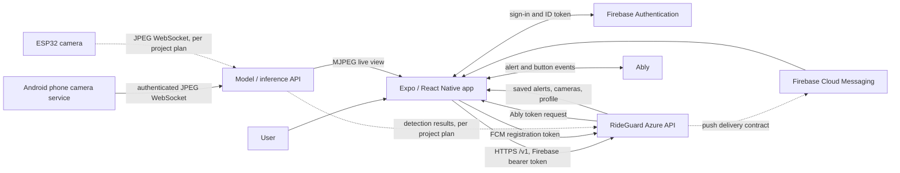
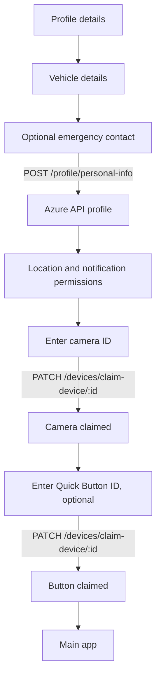

# RideGuard: frontend-to-backend flow

This describes the flows visible in this mobile repository as of 23 October 2026. The checkout contains the Expo/React Native app and its Android phone-capture module, but **does not contain the Azure API, model API, or hardware firmware source**. Backend internals below are limited to the API contracts used by the app and the architecture described in `docs/phone-camera-implementation-plan.md`; deployment behavior should be confirmed against those services.

## System at a glance

Solid arrows are directly represented in this checkout. Dashed arrows summarize an external-service flow described in the project plan; their implementation is not inspectable here. The API base URL defaults to the hosted Azure `/v1` endpoint and can be overridden with `EXPO_PUBLIC_API_BASE_URL`. The model API has a separate `EXPO_PUBLIC_INFERENCE_BASE_URL` setting.

## 1. Account creation and sign-in

1. **Create account:** The app sends `POST /auth/register` with username, email, and password. It tells the user to verify the email through a Firebase link.
2. **Email/password login:** The app signs in with Firebase, reloads the user, and requires a verified email. It gets a Firebase ID token, calls `GET /auth/is-old-user`, and, if needed, calls `POST /auth/register/verify` to establish the backend account. It then opens the main tabs or onboarding.
3. **Google login:** Google Sign-In returns a Google ID token; the app exchanges it for a Firebase credential. With the Firebase ID token, it calls `GET /auth/is-old-user` and routes to the main tabs or onboarding.
4. **App restart:** Firebase authentication persists locally. The root `useAuth` listener checks the restored user and backend profile before routing.
5. **Authenticated API requests:** The shared API client sends `Authorization: Bearer <Firebase ID token>` and expects JSON responses, usually `{ success, message, data, timestamp }`.
6. **Forgot password:** The app calls `POST /auth/forgot-password`; the current UI expects a Firebase password-reset link. The older OTP adapter exists in code but is disabled.

Main code: `src/modules/auth/`, `src/app/index.tsx`, `src/lib/firebase.ts`, and `src/shared/api/client.ts`.

## 2. Onboarding and device connection

The app saves claimed camera and button IDs in its local device store. Later, it requests `GET /devices/cameras` for the account's camera list, including device ID, source (`esp32` or `phone`), online state, and stream information. Device release uses `DELETE /devices/claim-device/:id`. Emergency contacts can subsequently be listed, created, edited, and deleted through `/profile/emergency-contacts`; create/edit requests use multipart form data so a photo can be included.

Main code: `src/modules/onboarding/`, `src/modules/camera-sensor/services/cameras.api.ts`, `src/modules/devices/`, and `src/modules/emergency-contacts/services/contacts.api.ts`.

## 3. Camera monitoring, detection, and alerts

**External camera path:** The project plan says an ESP32 sends JPEG frames to the model API at `/v1/inference/stream?device_id=<id>`. The mobile app does not upload those frames. It obtains its cameras from the Azure API and displays a selected camera's `/stream/{deviceId}/live.mjpeg` feed from the model API in a WebView while the screen is focused and the app is active.

**Phone camera path (Android):** The app first registers the installation with `POST /devices/phone`. On Start, it requests `POST /devices/phone/:deviceId/sessions` and receives a session ID and upload token. Its native CameraX foreground service then samples JPEG frames at the configured one-second interval and uploads them to the model API's `/inference/phone-stream` WebSocket. It stops at the configured ten-minute deadline or when the user stops it. The app ends the backend session with `DELETE /devices/phone/:deviceId/sessions/:sessionId` when it sees the native session end. The native service can continue while the React screen is unmounted; actual background and locked-screen reliability needs device testing.

**After inference:** The project plan describes model results being published to the backend, which associates a camera ID with its owner and creates alerts. The precise model, detection thresholds, result transport, alert persistence, and push policy cannot be confirmed from this checkout. In particular, the plan flags a possible non-threat alert issue that still needs backend verification.

**Alert delivery and history:** The app calls `GET /auth/ably-token`, subscribes to per-user, per-device Ably channels, and handles `alert.created` events. It also fetches `GET /alerts` with cursor pagination on launch, reconnect, foreground, and while the alerts screen is visible; this reconciles events missed while offline. Opening an alert calls `PATCH /alerts/:id/seen`, and marking one false calls `PATCH /alerts/:id/false-alarm`. `GET/PATCH /settings/auto-archive` reads and changes the server-backed archive period; alert payloads include archive state and deadlines. A physical device registers its native FCM token with `POST /notifications/register`; logout calls `DELETE /notifications/registrations/:installationId`.

Main code: `src/modules/phone-camera/`, `modules/phone-capture/`, `src/modules/camera-sensor/`, `src/modules/alerts/`, `src/shared/hooks/use-ably.ts`, and `src/modules/notifications/`.

## 4. Other user actions and current limits

| Feature | Current flow |
| --- | --- |
| Home ride Start/End | Changes local React state and timer; no ride-start or ride-end API request is made here. |
| Manual SOS screen | Long press starts a local ten-second countdown, then opens the active screen. The screen explicitly says contact delivery is unconfirmed; its Stop handler still has a backend TODO. Do not present this UI as confirmed SMS or emergency dispatch. |
| Quick Button test | Subscribes to Ably `rideguard:buttons:device` / `button.pressed`, filters by claimed button ID, and maps press types into short/long test results. Hardware-to-backend handling is outside this checkout. |
| Profile and contacts | `GET /profile/me`, `POST /profile/photo`, and emergency-contact CRUD call the API. Personal and vehicle edits currently throw an unavailable error. |
| Settings | Auto-archive uses the backend. Theme and several notification/location preferences are local; corresponding backend functions are placeholders. |
| MPIN | The backend adapter is explicitly disabled because no MPIN endpoints are connected in this checkout. |
| Demo/preview | Local demo and sample-alert states are UI previews, not backend accounts or alerts. |

## Key boundaries for backend documentation

To complete a server-side architecture document, confirm the Azure API's database/storage, Firebase token verification, device ownership rules, model-result transport, alert creation criteria, Ably publishing, FCM sending, emergency-contact delivery, and retention jobs in the backend repositories or deployed service. This mobile checkout shows what it calls and displays; it cannot by itself prove those server operations happened.
